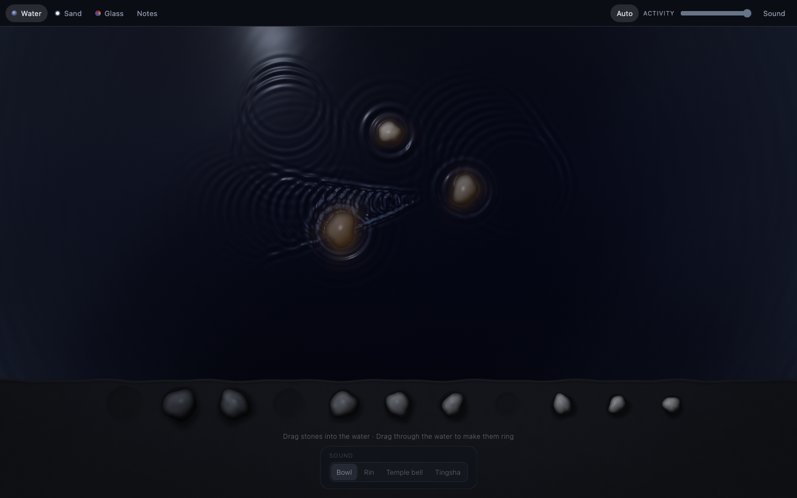
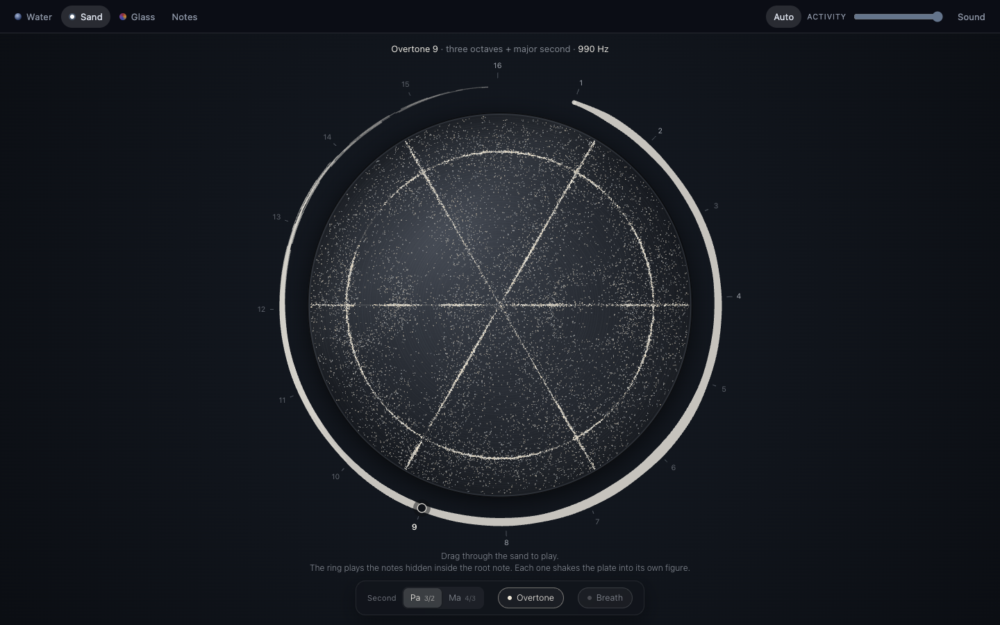
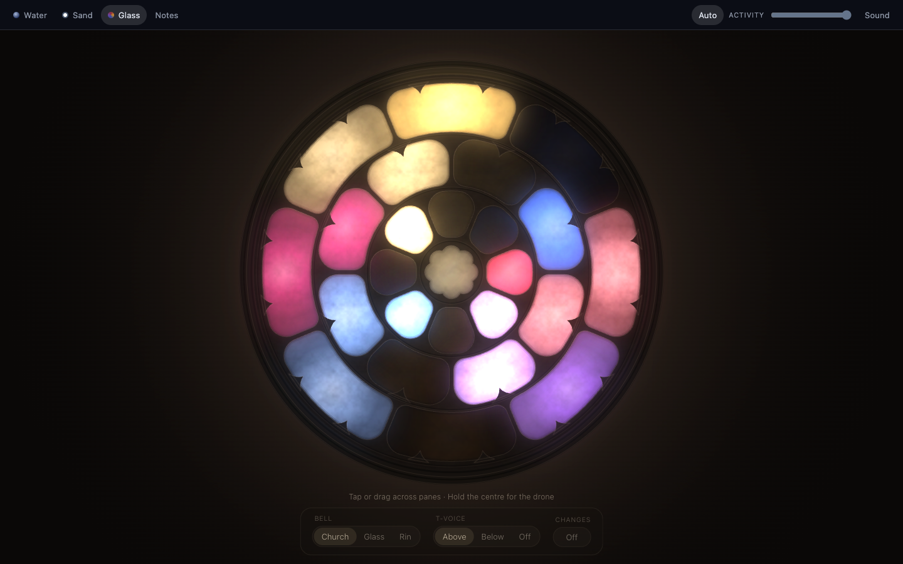
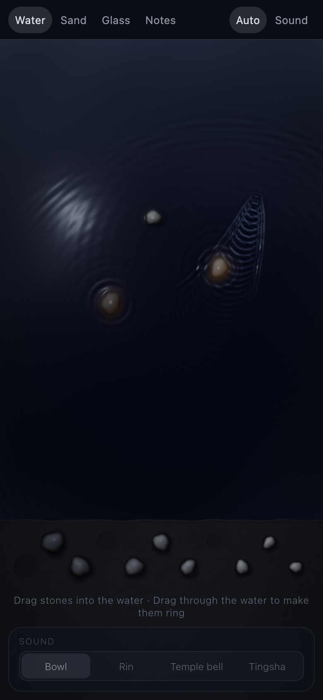
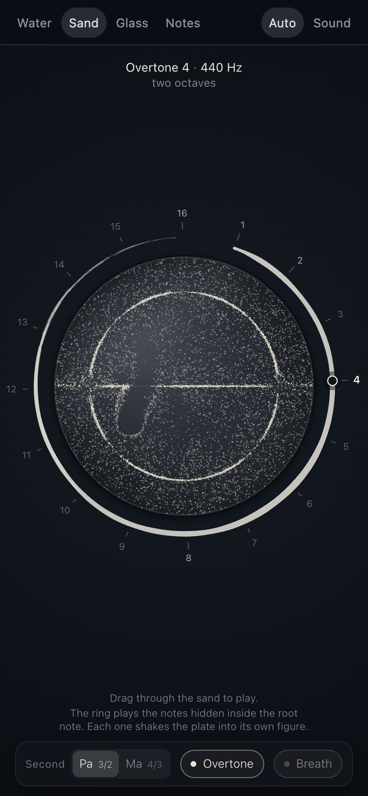
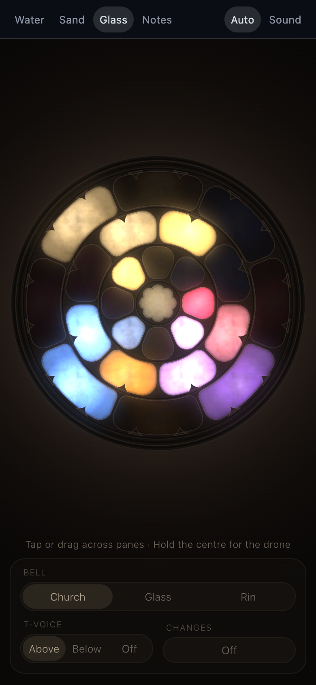

<h1 align="center">Ambient Rooms</h1>

<p align="center">
  A browser instrument for bells, bowls and drone.<br />
  Three rooms share one key, one scale and one drone. Play them by hand or let them play themselves.
</p>

<h2 align="center">
  <a href="https://graine-ambient.pages.dev/">Open the app → graine-ambient.pages.dev</a>
</h2>

<p align="center">
  <a href="https://graine-ambient.pages.dev/">
    
  </a>
</p>

## The rooms

### Water

Each stone is one note. Drag stones from the bank into the pool to choose the notes, then drag through the water: the stones you pass near begin to ring. A tap drops a single ripple that strikes the stones it reaches.

### Sand



A vibrating plate covered in sand. The ring steps through the overtones of the root note, one soft bell each, and the sand settles into that overtone's figure. Drag through the sand to play the plate directly.

### Glass



A rose window where every pane is a bell that stays lit for as long as it rings. Each note is answered by a second, quieter bell using Arvo Pärt's tintinnabuli rule. The centre holds the drone.

## Controls

| Control | What it does |
| --- | --- |
| **Auto** | Plays the room on screen with the same gestures a hand would use. You can play along. |
| **Activity** | How often Auto acts, from one event every 20–30 seconds to nearly continuous. |
| **Sound** | Root note, scale, drone timbre and level (0 is off), reverb, and dark or light theme. |
| **Notes** | The background: what each room draws on, how the sounds are built, tunings and sources. |

Sound carries across rooms, and a bell rung in one room shows up in the others.

<p align="center">
  
  &nbsp;
  
  &nbsp;
  
</p>

## How it works

- **No samples.** Every bell and bowl is built from sine tones, one per overtone, using partial ratios from acoustics papers on singing bowls, temple bells and church bells.
- **Just intonation.** Scales are whole-number ratios above the root, so every note lines up with the drone.
- **No dependencies and no build step.** Plain HTML, CSS and JavaScript modules on the Web Audio API, WebGL and Canvas.

## Run it locally

```sh
python3 -m http.server 4317 --directory prototypes
```

Then open http://localhost:4317/.

## Layout

| Path | Contents |
| --- | --- |
| `prototypes/index.html`, `shell.js`, `shell.css` | The shell: room tabs, Auto, the Sound panel |
| `prototypes/shared/engine.js` | Audio engine: bells, bowls, drone, reverb |
| `prototypes/shared/session.js` | State shared by every room |
| `prototypes/water/`, `plate/`, `rose/` | The Water, Sand and Glass rooms |
| `prototypes/notes.html` | The Notes page |

## Deploy

The site is a static folder on Cloudflare Pages.

```sh
npx wrangler pages deploy prototypes --project-name graine-ambient --branch main
```

## Made with AI

The code and the Notes page were generated almost entirely by AI coding agents, directed by the author. They can contain errors. The Notes page says which statements were checked against a source and which were not.

## Licence and sources

Everything in this repository is dedicated to the public domain under [CC0 1.0](LICENSE), without warranty. It contains no third-party code, samples or fonts.

Partial ratios, tunings and background come from the papers and articles listed under [Sources](https://graine-ambient.pages.dev/notes.html#sources) on the Notes page (`prototypes/notes.html`).
